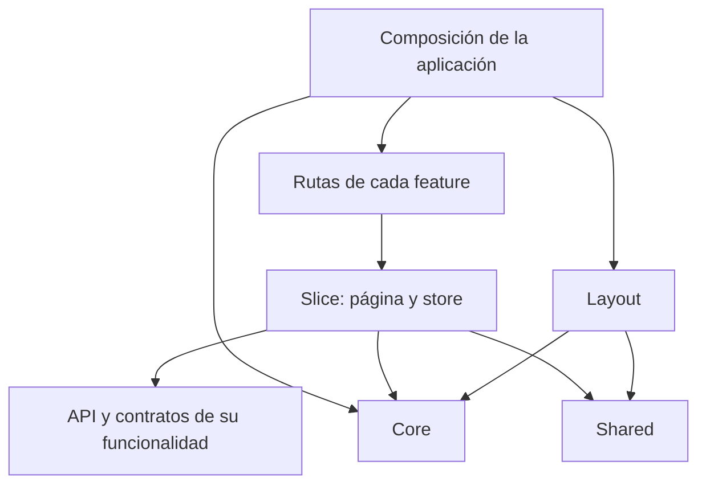

# Arquitectura del frontend: Vertical Slice

## Estado y objetivo

**Estado:** propuesta y plan de migración; la estructura descrita todavía no está implementada.
**Alcance de esta tarea:** documentar la arquitectura y la migración, sin mover archivos ni cambiar el comportamiento de la aplicación.

Organizar el frontend por funcionalidades y casos de uso, de modo que un cambio en «listar productos» se pueda resolver principalmente dentro de su propia carpeta. Cada slice reúne su página, estado, componentes específicos, validaciones y pruebas. La infraestructura global, el contenedor visual y la UI reutilizable tienen límites explícitos.

La base es Angular 22, componentes standalone, Signals, RxJS, Angular CDK y las herramientas actuales del proyecto. No se requiere incorporar NgRx, Nx ni una nueva biblioteca de estado.

## Diagnóstico del proyecto actual

- `auth/`, `productos/`, `usuarios/`, `mesas/` y `admin/` están directamente en `src/app/`.
- Dentro de las funcionalidades se separan archivos por tipo: `pages/`, `components/`, `interfaces/` y `access-data/`. Para cambiar un caso de uso hay que recorrer varias carpetas.
- `AuthService` combina HTTP, persistencia del token, sesión y navegación. `ProfileStore` ya centraliza el perfil de `/auth/me`, comparte peticiones y descarta respuestas de sesiones anteriores.
- `core/http/auth.interceptor.ts` depende del servicio ubicado en `auth/`. La infraestructura global queda acoplada a una carpeta que también contiene pantallas.
- `AdminLayout` está en `shared/layouts/`, pero conoce sesión, perfil y navegación administrativa. Por responsabilidad pertenece a `layout/`.
- Las páginas de productos, usuarios y mesas concentran estado y coordinación de operaciones. Son candidatas a extraer stores locales de forma gradual.
- Ya existen carga diferida de rutas, componentes reutilizables y pruebas con Vitest mediante el builder de Angular. Se conserva esa base.

## Estructura objetivo

El árbol muestra destinos y extracciones previstas. Los archivos nuevos se crean al ejecutar su etapa de migración; no se generan carpetas vacías ni stores sin una necesidad concreta. Los archivos `.spec.ts` se mantienen junto al código probado.

```text
src/app/
├── core/
│   ├── auth/
│   │   ├── auth.store.ts              # Sesión y token globales
│   │   ├── auth.api.ts                # HTTP de login, Google y perfil
│   │   ├── auth.guard.ts
│   │   ├── auth-user.interface.ts
│   │   ├── auth-response.interface.ts
│   │   └── profile.store.ts           # Perfil global; conserva su caché
│   └── http/
│       ├── auth-context.ts
│       └── auth.interceptor.ts
├── layout/
│   ├── app-shell/
│   │   ├── app-shell.ts
│   │   ├── app-shell.html
│   │   ├── app-shell.css
│   │   └── layout.store.ts            # Solo si el estado se comparte
│   ├── header/                        # Al extraer la cabecera del shell
│   └── sidebar/                       # Al extraer el menú del shell
├── shared/
│   ├── ui/
│   │   ├── confirm-dialog/
│   │   ├── dialog/
│   │   ├── tabla-base/
│   │   ├── paginador/
│   │   ├── form-field/
│   │   ├── form-select/
│   │   ├── form-textarea/
│   │   ├── file-dropzone/
│   │   └── theme-toggle/
│   └── services/
│       └── confirm-dialog.service.ts  # Unifica apertura mediante CDK
├── features/
│   ├── auth/
│   │   ├── auth.routes.ts
│   │   ├── login/
│   │   │   ├── login.page.ts
│   │   │   ├── login.page.html
│   │   │   └── login-form/
│   │   └── google-callback/
│   │       └── google-callback.page.*
│   ├── inicio/
│   │   ├── inicio.routes.ts
│   │   └── inicio.page.ts
│   ├── productos/
│   │   ├── productos.routes.ts
│   │   ├── productos.api.ts           # Operaciones usadas por varios slices
│   │   ├── producto.interface.ts      # Contratos compartidos en productos
│   │   ├── producto-tipo.type.ts
│   │   ├── listar/
│   │   │   ├── listar-productos.page.ts
│   │   │   ├── listar-productos.page.html
│   │   │   ├── listar-productos.page.css
│   │   │   ├── listar-productos.store.ts
│   │   │   ├── productos-consulta.interface.ts
│   │   │   └── productos-listado.interface.ts
│   │   └── crear/
│   │       ├── crear-producto.page.*
│   │       └── crear-producto.store.ts # Si la coordinación lo justifica
│   ├── usuarios/
│   │   ├── usuarios.routes.ts
│   │   └── listar/
│   │       ├── listar-usuarios.page.*
│   │       ├── listar-usuarios.store.ts
│   │       ├── listar-usuarios.api.ts
│   │       ├── usuarios-tabla/
│   │       ├── usuarios-filtros/
│   │       └── ...                    # Tipos y constantes del listado
│   └── mesas/
│       ├── mesas.routes.ts
│       └── plano/
│           ├── plano.page.*
│           ├── plano.store.ts
│           ├── plano.api.ts
│           ├── mesa.interface.ts
│           ├── zona.interface.ts
│           └── formulario-dialog/
├── app.ts
├── app.html
├── app.css
├── app.routes.ts
└── app.config.ts
```

`*.page.*` representa los archivos TypeScript, HTML y CSS que correspondan. Los nombres descriptivos, como `listar-productos.store.ts`, permiten identificar el caso de uso incluso fuera de su carpeta. Se conserva el uso actual de `.ts`, `.html` y `.css`; no es necesario añadir `.component` a todos los componentes.

Se omiten `matriculas/` y `ventas/` de la estructura actual porque no existen como funcionalidades implementadas en este frontend. Si se incorpora ventas, se crea su feature y se define el alcance de su estado según el flujo real.

## Responsabilidades y dependencias

| Área                              | Responsabilidad                                  | Dependencias permitidas dentro de la app                    |
| --------------------------------- | ------------------------------------------------ | ----------------------------------------------------------- |
| `core`                            | Sesión, perfil e infraestructura HTTP global     | Otros archivos de `core` sin ciclos                         |
| `layout`                          | Shell, navegación y estado visual del contenedor | `core`, `shared` y otros elementos de `layout`              |
| `shared`                          | UI y utilidades técnicas reutilizables           | Otros elementos de `shared`                                 |
| `features/<feature>/<slice>`      | Un caso de uso completo                          | Su slice, contratos de su feature, `core` y `shared`        |
| `app.routes.ts` y `app.config.ts` | Componer rutas y proveedores de la aplicación    | Entradas de rutas de features, shell y proveedores globales |

Las librerías externas y la configuración de `src/environments/` quedan fuera de esta tabla. Las APIs toman la URL base del environment correspondiente; no se duplican URLs en páginas ni stores.



Reglas de diseño:

1. `core` y `shared` no importan páginas, stores ni APIs de `features`.
2. `layout` no importa páginas de negocio. El router las presenta mediante `RouterOutlet`.
3. Una feature no importa archivos internos de otra feature. Si aparece una necesidad real de integración, se diseña un contrato explícito; no se mueve automáticamente todo a `shared`.
4. Un slice no importa el store ni la página de un slice hermano. El código reutilizado dentro de una feature se coloca en su raíz o en una carpeta con responsabilidad concreta.
5. Los tipos permanecen cerca de su consumidor. Solo los usados por varios slices suben a la raíz de la feature; los del usuario autenticado pertenecen a `core/auth`.
6. `shared/ui` recibe datos y emite eventos. No consulta productos, mesas, usuarios ni sesión. `ConfirmDialogService` abre el diálogo y devuelve el resultado; el consumidor decide qué operación ejecutar.
7. No se introducen capas `domain/application/infrastructure`, repositorios genéricos, barrels globales ni carpetas `utils` por defecto. Se extraen piezas cuando aportan una responsabilidad o reutilización concreta.

Estas reglas son convenciones de revisión. Las carpetas por sí solas no impiden imports incorrectos; actualmente el proyecto no tiene un target de lint que haga cumplir estos límites.

## Estado y alcance de los stores

La ubicación del archivo expresa su responsabilidad. El proveedor de Angular determina quién comparte la instancia.

| Estado                                           | Dueño                           | Provisión                              | Reinicio esperado                                         |
| ------------------------------------------------ | ------------------------------- | -------------------------------------- | --------------------------------------------------------- |
| Token y sesión                                   | `AuthStore`                     | Una instancia en el inyector raíz      | Logout, sesión inválida o cambio de sesión                |
| Perfil autenticado                               | `ProfileStore`                  | Una instancia en el inyector raíz      | Logout o cambio de sesión                                 |
| Menú y secciones abiertas                        | `LayoutStore`, si se extrae     | `providers` de `AppShell`              | Destrucción del shell                                     |
| Filtros, página, carga y operaciones del listado | Store de cada página            | `providers` del componente de página   | Destrucción de esa página                                 |
| Datos transitorios de un formulario simple       | Componente del formulario       | Signals locales                        | Destrucción del componente                                |
| Flujo que abarca varias pantallas                | Store de feature, cuando exista | Proveedor en el límite común del flujo | Reset explícito al terminar, cancelar o cambiar de sesión |

Un store de página se declara sin provisión raíz y se registra, por ejemplo, con `providers: [ListarProductosStore]` en su página. Los componentes hijos que lo necesiten comparten esa instancia; no vuelven a proveerlo. No se aplica `providedIn: 'root'` a todos los stores.

Los proveedores de ruta permiten compartir servicios entre rutas hijas, pero no se debe asumir que navegar fuera siempre destruye inmediatamente el inyector y reinicia el estado. Para un flujo con varias páginas se define explícitamente su política de limpieza. Si en el futuro se habilita reutilización de rutas, también se revisa la política de los stores de página.

Un servicio HTTP sin estado puede tener provisión raíz sin convertir los filtros y datos de cada pantalla en estado global. La carga diferida depende además de dónde se importe, no solo de su proveedor.

### Separación dentro de cada slice

- **Página:** composición de UI, formulario, accesibilidad, navegación y apertura de diálogos. Los eventos de puntero y foco permanecen aquí o en componentes específicos.
- **Store:** estado de carga, error y operación pendiente; consulta activa; resultados; coordinación de comandos e invalidación del listado.
- **API:** contratos HTTP, parámetros, rutas, `FormData` y respuestas tipadas. No muestra mensajes ni navega.
- **UI específica:** tabla, filtros o formulario del caso de uso. Permanece en el slice mientras no tenga consumidores reales fuera de él.

Se usan `signal`, `computed` y `linkedSignal` para estado y valores derivados. Se conserva RxJS para debounce, cancelación y composición asíncrona. Las lecturas reactivas pueden usar `httpResource` creado en el contexto de inyección del store; los comandos usan `HttpClient` a través de la API. Al migrar el método `listado()` actual, se lleva la creación del recurso al store y la construcción de la petición a la API. No se mantiene una segunda copia mutable de los resultados del recurso.

Se cancelan suscripciones vinculadas al consumidor con las herramientas de Angular, como `takeUntilDestroyed`, cuando corresponda. Los errores se traducen a mensajes en el caso de uso, conservando las diferencias entre acceso denegado, validación, conflicto y fallo de conexión. Las actualizaciones concurrentes no deben restaurar resultados de una consulta anterior.

## Autenticación y perfil

`features/auth` contiene únicamente las pantallas de login y callback y su UI. El resto de funcionalidades consulta la sesión y el perfil en `core/auth`.

- `AuthApi` encapsula las llamadas existentes de login, configuración de Google, intercambio de código y `/auth/me`.
- `AuthStore` asume las operaciones de sesión del actual `AuthService`: token de solo lectura, restauración, login, intercambio y logout. Puede coordinar la navegación de cierre de sesión y limpiar el perfil.
- `ProfileStore` conserva el perfil, estado de carga, petición compartida, reintento y protección frente a respuestas antiguas. Depende de `AuthApi`, sin depender de `AuthStore`.
- El interceptor lee el token de `AuthStore`; mantiene el filtro de origen y prefijo de API, `SKIP_AUTH`, respeto a un encabezado `Authorization` existente y cierre de sesión por un 401 de la sesión vigente.
- No se lanzan peticiones HTTP en los constructores de estos servicios. La carga se inicia mediante métodos explícitos, para evitar ciclos al resolver dependencias desde el interceptor.

Se conserva la clave `restaurant.auth` y la persistencia exclusiva del access token. El perfil no se persiste. Se mantiene `withCredentials` en el intercambio de Google y la exclusión de autenticación en las peticiones públicas.

Antes de cargar datos dependientes del rol, la pantalla debe esperar a que el perfil esté disponible o reaccionar a su estado. Por ejemplo, el plano de mesas no debe depender únicamente de comprobar el rol en su constructor mientras `/auth/me` todavía está cargando. Las comprobaciones de UI y guards complementan la autorización que realiza el backend.

## Rutas y carga diferida

Se conservan las URLs existentes:

| URL                      | Destino                     |
| ------------------------ | --------------------------- |
| `/`                      | Redirección a `/auth/login` |
| `/auth/login`            | Slice de login              |
| `/auth/callback`         | Slice de callback de Google |
| `/admin`                 | Shell protegido e inicio    |
| `/admin/productos`       | Listar productos            |
| `/admin/productos/nuevo` | Crear producto              |
| `/admin/usuarios`        | Listar usuarios             |
| `/admin/mesas`           | Plano de mesas              |

`app.routes.ts` compone `/auth` y el shell `/admin`. Bajo el shell delega en `inicio.routes.ts`, `productos.routes.ts`, `usuarios.routes.ts` y `mesas.routes.ts` mediante `loadChildren`. Cada archivo de rutas carga sus páginas con `loadComponent`. No se importan páginas estáticamente desde el shell o desde un índice global.

En productos se declara `nuevo` y luego la ruta vacía con `pathMatch: 'full'`. La estructura de carpetas no obliga a cambiar segmentos de URL. `app.config.ts` conserva `provideRouter`, `provideHttpClient` y el interceptor global.

## Mapa de migración

| Origen actual, relativo a `src/app/`                                       | Destino previsto                                                                                             |
| -------------------------------------------------------------------------- | ------------------------------------------------------------------------------------------------------------ |
| `auth/access-control/auth.service.ts`                                      | Separar en `core/auth/auth.store.ts` y `core/auth/auth.api.ts`                                               |
| `auth/access-control/auth.guard.ts`                                        | `core/auth/auth.guard.ts`                                                                                    |
| `auth/stores/profile.store.ts` y pruebas                                   | `core/auth/`                                                                                                 |
| `auth/interfaces/*`                                                        | `core/auth/`, conservando los contratos                                                                      |
| `auth/auth.routes.ts`, `auth/pages/*`                                      | `features/auth/` y sus slices                                                                                |
| `auth/components/login-form/*`                                             | `features/auth/login/login-form/`                                                                            |
| `shared/layouts/admin/admin-layout.*`                                      | `layout/app-shell/app-shell.*`                                                                               |
| `shared/components/*`                                                      | `shared/ui/*`                                                                                                |
| `admin/pages/home/admin-home.ts`                                           | `features/inicio/inicio.page.ts`                                                                             |
| `productos/pages/productos/*`                                              | `features/productos/listar/`                                                                                 |
| `productos/pages/crear-producto/*`                                         | `features/productos/crear/`                                                                                  |
| `productos/access-data/productos.service.ts`                               | `features/productos/productos.api.ts`, separando recurso y estado                                            |
| `productos/interfaces/*`                                                   | Slice consumidor o raíz de productos si se comparten; por ejemplo `ProductoCrear` también se usa para editar |
| `usuarios/pages/usuarios/*`, `components/*`, `interfaces/*`, `constants/*` | `features/usuarios/listar/`                                                                                  |
| `usuarios/access-data/usuarios.service.ts`                                 | `features/usuarios/listar/listar-usuarios.api.ts`                                                            |
| `usuarios/usuarios.routes.ts`                                              | `features/usuarios/usuarios.routes.ts`                                                                       |
| `mesas/pages/plano/*`, `components/formulario-dialog/*`                    | `features/mesas/plano/`                                                                                      |
| `mesas/access-data/mesas.service.ts`                                       | `features/mesas/plano/plano.api.ts`; extraer `Mesa` y `Zona` junto a ella                                    |

## Plan de ejecución incremental

Cada etapa debe dejar la aplicación compilando. Se actualizan imports de producción y de pruebas, rutas dinámicas y referencias a plantillas/estilos al mover archivos. Se separan movimientos mecánicos de cambios de responsabilidad para facilitar la revisión.

1. **Registrar la línea base.** Ejecutar build y pruebas existentes con Angular CLI. Anotar cualquier fallo previo antes de atribuirlo a la migración. Confirmar navegación, login y carga de las pantallas actuales.
2. **Establecer `core/auth`.** Mover guard, contratos, perfil y pruebas; trasladar inicialmente `AuthService` conservando su API. Actualizar todos sus consumidores y el interceptor. Después separar `AuthApi` y `AuthStore`, adaptar las pruebas y retirar `AuthService` cuando no tenga consumidores. Verificar token restaurado, Google, logout, 401 y caché del perfil.
3. **Separar layout y UI común.** Mover `AdminLayout` a `AppShell` y `shared/components` a `shared/ui`. Extraer `ConfirmDialogService` para las confirmaciones repetidas del shell y mesas. Extraer header, sidebar y `LayoutStore` solo si comparten estado. Mantener foco, Escape y cierre del menú.
4. **Migrar productos como primer conjunto de slices.** Crear sus rutas; mover listado, creación y contratos con sus pruebas. Separar transporte y estado; extraer `ListarProductosStore`. Conservar filtros, paginación, edición, baja, imagen, disponibilidad y mensajes tras crear. La edición sigue dentro del listado hasta que exista una necesidad de navegación propia.
5. **Migrar usuarios.** Agrupar listado, tabla, filtros, tipos y constantes; extraer store y API locales. Conservar debounce de 300 ms, reinicio de página al cambiar filtros y estabilidad del paginador durante la carga.
6. **Migrar mesas e inicio.** Agrupar plano, diálogo, API y modelos. Extraer coordinación de datos al store y mantener interacción de arrastre/teclado en la UI. Asegurar que la carga inicial reaccione a la disponibilidad del perfil. Crear las rutas de inicio y mesas.
7. **Cerrar la migración.** Eliminar archivos anteriores ya sustituidos, buscar imports obsoletos y revisar dependencias. Ejecutar build, pruebas y recorrido de las URLs existentes. Actualizar este documento para distinguir la estructura implementada de las extracciones pendientes.

No se cambian endpoints, contratos del backend, diseño visual ni política de persistencia durante esta migración. No se reorganiza el repositorio de la API.

## Verificación y criterios de finalización

Usar los targets `build` y `test` del MCP de Angular para el proyecto `front-restaurant`. Como alternativa local: `npm run build` y `npm test -- --watch=false`. No ejecutar Vitest directamente: las pruebas dependen del builder de Angular.

- [ ] La estructura implementada coincide con los slices documentados y no quedan imports de las carpetas sustituidas.
- [ ] Build de producción y pruebas pasan, o los fallos previos quedan identificados y separados.
- [ ] `core` y `shared` no dependen de features; ninguna feature importa páginas o stores de otra.
- [ ] Todas las URLs de la tabla mantienen su comportamiento y carga diferida.
- [ ] Token restaurado, peticiones públicas, interceptor, Google, logout y perfil conservan sus garantías actuales.
- [ ] Los filtros y estados de operación de las páginas no se comparten accidentalmente entre instancias.
- [ ] Las páginas dependientes del perfil funcionan también al entrar mediante una URL directa.
- [ ] Crear, editar, dar de baja y cambiar disponibilidad o imagen de productos siguen funcionando.
- [ ] Usuarios conserva debounce, filtros, paginación y estados de acceso denegado.
- [ ] Mesas conserva operaciones de zonas/mesas y movimiento mediante puntero y teclado.
- [ ] Diálogos y menú conservan foco, etiquetas accesibles y controles de teclado.

Las pruebas existentes se mueven con su código. Se añaden pruebas de comportamiento cuando la extracción cambie la coordinación: aislamiento y reinicio del store, carga tras obtener perfil y descarte de respuestas antiguas. El movimiento de carpetas por sí solo no requiere pruebas que comprueben nombres de directorios.

## Referencias y decisiones

Se consultó el MCP de Angular: `list_projects` detectó Angular 22; `get_best_practices` aportó las convenciones de esa versión y `search_documentation` consultó el índice de documentación v22.

- [Organización por áreas funcionales](https://angular.dev/style-guide#organize-your-project-by-feature-areas): respalda agrupar código relacionado y pruebas cercanas. La división concreta `core/layout/shared/features` es una decisión de este proyecto.
- [Inyección jerárquica](https://angular.dev/guide/di/hierarchical-dependency-injection): fundamenta la separación entre servicios globales y estado provisto por componentes o límites de flujo.
- [Carga de rutas](https://angular.dev/guide/routing/loading-strategies): fundamenta el uso de `loadChildren` y `loadComponent`.

La propuesta inicial se conserva en sus cuatro áreas principales. Se concreta con los casos de uso reales, se separa la UI de autenticación de la sesión global, y se conserva `ProfileStore` para no duplicar la fuente de verdad del perfil. Se prioriza una migración gradual con contratos y URLs estables.
